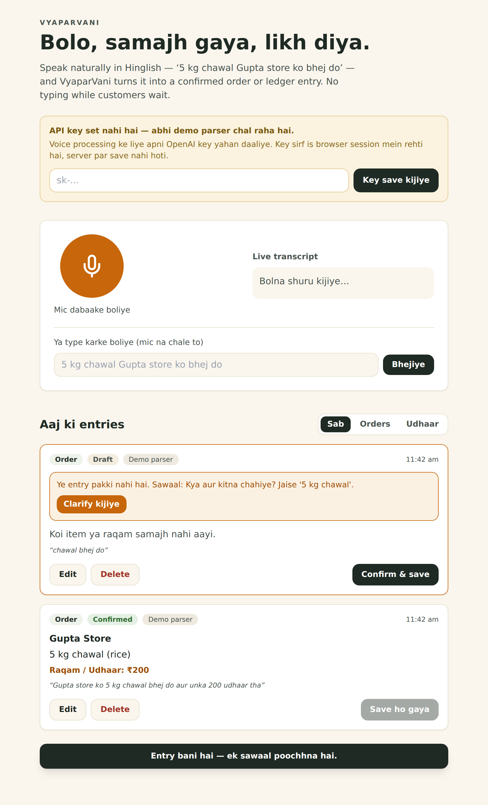
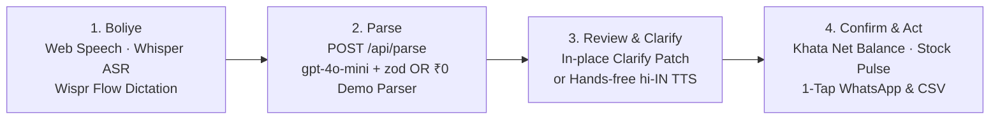

<div align="center">

# VyaparVani

### **Bolo, samajh gaya, likh diya.**

*Voice-first Hinglish & Devanagari order, khata, and local stock assistant built for India's 13 million kirana stores.*

[](https://github.com/BangerSoul/vyaparvani/actions/workflows/ci.yml)


[**Live Demo**](https://vyaparvani-iota.vercel.app) · [**Quick Start**](#quick-start) · [**Features**](#core-capabilities) · [**Architecture**](#architecture--resilience) · [**Eval & CI**](#golden-eval--ci-verification) · [**90s Demo Flow**](#90-second-counter-demo-flow)

<br />



<br />

<sub><b>Counter Desk UI (zero-key Demo mode):</b> voice mic + Hands-free TTS + Wispr Flow Dictation Mode, clickable Hinglish sample chips, Stock Pulse alerts, live <code>No-edit accuracy</code> KPI, inline <code>Clarify kijiye</code> patching, signed <code>Khata (Parties)</code> net balances, and 1-tap WhatsApp slips.</sub>

</div>

---

## Why VyaparVani

India's **13 million kirana stores** handle roughly **88% of unorganized retail** on paper notebooks and memory. Text-heavy POS apps fail at the counter because shopkeepers cannot type invoices while customers wait.

**VyaparVani** meets the shopkeeper mid-conversation: speak one natural Hinglish or Devanagari sentence — *"3 packet surf Gupta store ko bhej do aur unka 200 udhaar tha"* — and get a structured, editable order, signed khata balance, and stock update in seconds.



---

## Core Capabilities

| Area | What Is Shipped |
| --- | --- |
| **Multi-Path Voice & Dictation** | Browser **Web Speech API** (`hi-IN`) via `SpeechInputAdapter` (`src/lib/speech-adapter.ts`); **OpenAI Whisper** `MediaRecorder` fallback (`POST /api/transcribe`, `whisper-1`) for Safari/Firefox or noisy counters when a key is set; **Wispr Flow Dictation Mode** (auto-focus + 1.1s pause auto-parse + copyable kirana dictionary & snippets); and **Hands-free mode** (auto-submit on speech end + `hi-IN` `window.speechSynthesis` readback). |
| **Hinglish & Devanagari Parsing** | Parses Romanized Hinglish + Devanagari (`hi-IN`), Indian numerals & fractions (`aadha`, `paav`, `sava`, `dedh`, `dhai`, `saadhe`), attached currency & units (`250rs`, `₹500`, `500/-`, `5kg`), price-denominated orders, branded multi-word items, IST relative dates (`aaj`, `kal`, `parso`), and multi-instruction `aur` splits. |
| **Clarification, Not Guessing** | Low-confidence or ambiguous utterances surface a targeted Hinglish prompt (`"Clarify kijiye"`). Replies patch `missing` fields on the existing draft card in place (`mergeDemoClarification` / LLM draft context) instead of creating broken duplicate cards, while `confirmEntry` guards against `0`-quantity or incomplete drafts. |
| **Signed Khata (`Parties`)** | Distinguishes `credit_given` (`udhaar` / `baki` → `+₹`) from `payment_received` (`wasooli` / `jama` / `clear` → `-₹`), computes live per-party net balances (`computePartyBalances`), filters entries by party, and supports 1-click `"Wasooli record karo"`. |
| **Stock Pulse & WhatsApp Loop** | Local kirana SKU stock (`src/lib/inventory.ts`) automatically deducts on order confirmation, parses voice restocks (`"10 kg chawal stock mein add karo"`), flags low stock with 1-tap `Reorder on WhatsApp`, and exports confirmed orders via `WhatsApp pe bhejein` (`wa.me`) or `Distributor Order Sheet (CSV)`. |
| **Zero-Key Sandbox & Telemetry** | Starts fully functional with **zero API keys** (falls back to `parseDemoUtterance` + clickable Hinglish sample chips), groups entries into `Aaj` vs `Pichhle din`, tracks live `No-edit accuracy` (`edited?: boolean`), and supports `StorageAdapter` JSON export/import. |

---

## Quick Start

### 1. Docker Compose (Recommended — Zero Secret Keys Needed)

```bash
docker compose up --build
# App ready at http://localhost:3000 (starts in Demo mode with no env vars)
```

To enable `gpt-4o-mini` parsing and Whisper `/api/transcribe` via server environment variables:

```bash
OPENAI_API_KEY=sk-... OPENAI_MODEL=gpt-4o-mini docker compose up --build
```

You can also paste an `sk-...` key inside the in-app banner at any time (`sessionStorage` only — never persisted on the server; remove any time with **Key hatayein**).

### 2. Local Development (Node.js 22+)

```bash
npm install
npm run dev        # http://localhost:3000
```

### Environment Variables & API Endpoints

| Variable | Required | Default | Purpose |
| --- | --- | --- | --- |
| `OPENAI_API_KEY` | No | unset | Enables `gpt-4o-mini` in `/api/parse` and `whisper-1` in `/api/transcribe`. Unset → Demo mode. |
| `OPENAI_MODEL` | No | `gpt-4o-mini` | Model ID used by Vercel AI SDK `generateObject`. |
| `OPENAI_TRANSCRIBE_MODEL` | No | `whisper-1` | Audio transcription model used by `POST /api/transcribe`. |

| Endpoint | Method | Purpose |
| --- | --- | --- |
| `/api/health` | `GET` | Container healthcheck returning `{ ok: true, status: "healthy", mode: "demo" \| "model", timestamp }`. |
| `/api/parse` | `GET`, `POST` | Checks `hasServerKey`; parses `{ utterance, existingEntry? }` via OpenAI or ₹0 Demo parser. |
| `/api/transcribe` | `POST` | Transcribes `multipart/form-data` `audio` blobs (`<= 10 MB`) with kirana prompt biasing (`400` if no key). |

---

## Architecture & Resilience

Every external dependency has an explicit cost, rate-limit, and outage fallback:

| Layer | Shipped Implementation | Cost / Rate-Limit / Outage Fallback | Swappable Interface |
| --- | --- | --- | --- |
| **Voice Capture** | Web Speech API (`hi-IN`) + Wispr Flow Dictation Mode | Typed Hinglish + Wispr Flow Dictation work 100% offline; Whisper `/api/transcribe` (`10 MB` cap, `20s` timeout) when key set | `SpeechInputAdapter` (`src/lib/speech-adapter.ts`) |
| **NL Parsing** | Vercel AI SDK `generateObject` + `zod` (`gpt-4o-mini`) | Per-attempt `15s` `AbortController` (`25s` total budget), bounded `429` backoff (`600ms` / `1200ms`), explicit `401`/`429`/`504` handling; no-key switches to ₹0 Demo parser | Any AI SDK provider / BYOK sharing `src/lib/schema.ts` |
| **No-Key Fallback** | `parseDemoUtterance` & `mergeDemoClarification` | Runs 100% locally in Node.js with **₹0 cost**, zero network calls, and zero rate limits | Local SLM / WebLLM |
| **Persistence** | Browser `localStorage` (`vyaparvani.entries.v1`, `vyaparvani.stock.v1`) | `try/catch` guarded persistence across reloads + JSON export/import; zero database dependency | `StorageAdapter` (`src/lib/store.ts`) → Postgres |
| **Container** | Multi-stage `node:22-alpine` (`output: "standalone"`) | Non-root `app` user, no secrets baked in, built-in `HEALTHCHECK` on `/api/health` | Standard Docker / Vercel (`next.config.mjs`) |

---

## Golden Eval & CI Verification

[`eval/golden.json`](eval/golden.json) holds **60 golden Hinglish & Devanagari utterances**, validated strictly by [`scripts/eval-parser.mjs`](scripts/eval-parser.mjs) (asserting full normalized `product`, `ledgerAction`, IST `dueDate`, `missingIncludes`, `p50`/`p95` latency, and exiting non-zero on any mismatch):

- **36** confident orders (Indian fractions `aadha`/`paav`/`sava`/`dedh`/`dhai`/`saadhe`, attached units `5kg`, price-denominated orders, branded multi-word items like `Britannia biscuits` & `Amul butter`, IST `dueDate`)
- **11** confident ledger entries (`credit_given` and `payment_received` including `250rs`, `₹500`, `500/-`)
- **4** multi-intent entries (**2** mixed `order` + `udhaar` and **2** `aur` multi-instruction splits across Hinglish & Devanagari)
- **9** safety & clarification edge cases (zero-qty, nameless ledger, missing amount/product/party)

```bash
# Demo mode (no API key required)
npm run eval                                         # against http://127.0.0.1:3000

# Live gpt-4o-mini mode (forwards OPENAI_API_KEY via x-openai-key)
OPENAI_API_KEY=sk-... node scripts/eval-parser.mjs http://127.0.0.1:3000 --llm --delay-ms=150
```

| Verification Suite | Mode / Scope | Observed Result |
| --- | --- | --- |
| **`npm run eval` (60 cases)** | Demo regex parser (no key) | **60/60 exact-match (100%)** — CI-verified |
| **`--llm` (`gpt-4o-mini`)** | Live `OPENAI_API_KEY` | Harness wired via `--llm` + `x-openai-key`; pending live key benchmark |
| **`npm run typecheck` + `npm run build`** | Next.js 15 standalone + TS 5.8 | **Pass** — CI-verified |
| **Playwright E2E Suites** | `test-p0.mjs`, `test-m3.mjs`, `test-p3.mjs`, `test-finale-e2e.mjs` | **Pass** (`0` page errors, `0` HTTP `>=500`) — CI-verified |
| **Docker Standalone Build** | `docker build` + `/api/health` + `/api/parse` | **Pass** (Demo mode, zero keys) — CI-verified |

---

## 90-Second Counter Demo Flow

1. **Click or speak a mixed line:** *"3 packet surf Gupta store ko bhej do aur unka 200 udhaar tha"* → Confirm entry; `No-edit accuracy` updates to `100% (1/1)` and `Stock Pulse` flags `Low stock: surf (1 packet bacha)` with a WhatsApp reorder link.
2. **Test inline clarification:** Click sample chip *"chawal bhej do"* → Click `"Clarify kijiye"` → Reply `"5 kg Verma store"` → Same card patches in place without spawning an orphan card → Confirm.
3. **Check signed ledger:** Open **`Khata (Parties)`** → Review `Gupta Store` (`₹200 baki`) and trigger `"Wasooli record karo"` to settle in one tap.
4. **Export to customer & distributor:** Click **`WhatsApp pe bhejein`** (`wa.me` pre-filled slip) or **`Distributor Order Sheet (CSV)`**.

---

## Project Structure

```text
.
├── .github/workflows/ci.yml        # Typecheck, standalone build, 60-case eval, Playwright E2E, deck & Docker CI
├── decks/
│   ├── assets/ui-screenshot.png    # CI-captured Counter Desk UI screenshot
│   └── vyaparvani-idea.deck.json   # 12-slide pitch deck source
├── eval/golden.json                # 60 Hinglish & Devanagari golden test utterances
├── scripts/
│   ├── build-deck.py               # Native selectable-text 16:9 PDF deck generator (reportlab + PIL)
│   ├── capture-ui.mjs              # Playwright UI screenshot generator
│   ├── eval-parser.mjs             # 60-case eval harness (Demo & --llm modes)
│   └── test-{p0,m3,p3,finale-e2e}.mjs  # Automated verification & 4-beat E2E suites
├── src/
│   ├── app/
│   │   ├── api/health/route.ts     # Docker/CI health endpoint
│   │   ├── api/parse/route.ts      # OpenAI gpt-4o-mini (AbortController + 429 backoff) & Demo fallback
│   │   ├── api/transcribe/route.ts # OpenAI Whisper transcription fallback
│   │   ├── layout.tsx              # Root metadata & hi-Latn locale
│   │   └── page.tsx                # Counter Desk UI, Wispr Dictation, Khata tab, Stock Pulse & CSV
│   ├── components/
│   │   ├── EntryCard.tsx           # Draft/confirmed cards, mixed amount display, full edit mode & WhatsApp link
│   │   └── MicControl.tsx          # Speech capture control with stop lifecycle & accumulated segments
│   └── lib/
│       ├── demo-parser.ts          # Hinglish + Devanagari parser & structured clarification merger
│       ├── inventory.ts            # Lightweight localStorage SKU stock deduction & voice restock
│       ├── schema.ts               # Shared zod contracts, trade glossary & IST SYSTEM_PROMPT builder
│       ├── share.ts                # wa.me slip & sanitized CSV builders
│       ├── speech-adapter.ts       # WebSpeechAdapter & WhisperApiAdapter
│       └── store.ts                # StorageAdapter, party net balances & JSON backup
├── Dockerfile                      # Multi-stage node:22-alpine standalone build
└── docker-compose.yml              # One-command startup (no secret keys required)
```

---

## Scope & Limits

- **Single-user counter prototype:** No authentication; entries and stock persist in browser `localStorage` with JSON backup export/import.
- **Language scope:** Romanized Hinglish and Devanagari (`hi-IN`) are the verified paths; Demo-mode `60/60` scores measure the deterministic rule parser, while `--llm` benchmarks require an `OPENAI_API_KEY`.
- **Browser speech API:** Native Web Speech mic capture works in Chrome/Edge; Safari/Firefox fall back cleanly to Whisper `/api/transcribe` (when a key is provided), **Wispr Flow Dictation Mode**, typed input, or clickable sample chips.
